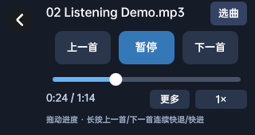
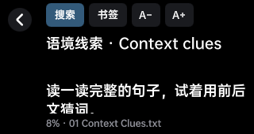
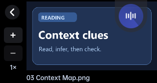
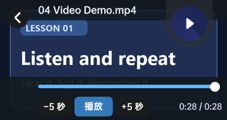

# PenMods · 有道词典笔 YDP02X

适用于 YDP02X 固件 2.1.2。把 AI 对话、听力练习、文本阅读和图像视频预览集中在词典笔的小屏幕上。

## AI 助手

- 点主页的 **AI 助手** 卡片，输入问题或扫描文字提问。
- 对话保存在笔上。打开 **历史** 可以切换会话，点击会话标题可以改名，也可以新建、删除和继续对话。
- 在 **设置 → AI 助手** 配置服务地址、API Key 和模型，支持 DeepSeek、Kimi、通义千问、智谱 GLM、豆包、OpenAI、OpenRouter 和自定义 OpenAI 兼容服务。

## 听力练习

从 **听力练习 → 我的导入** 打开 MP3。拖动进度条定位，短按上一首或下一首切歌，长按连续快退或快进。**选曲** 列出当前文件夹里的音频，倍速可在 0.8×、1×、1.2× 和 1.5× 间切换。通过 **更多** 进入歌词与复读界面。

## 文本阅读

- **我的导入 → 找文本** 支持按文件名或正文搜索，包含子文件夹。正文结果显示摘要，点开即可跳到命中位置。
- 阅读时可以搜索当前文件、添加书签和调节字号。再次打开会恢复上次的阅读位置。
- 支持 TXT、Markdown 等纯文本，单文件最大 128 MB。

## 图片和视频

 

- **图片预览**支持 PNG、JPG、JPEG。在 **我的导入** 点开图片，使用左侧按钮放大到 2× 或 4×，拖动查看细节。
- **视频播放**采用软件解码。点按画面呼出控制条，可以播放、暂停、拖动进度，以及向前或向后跳 5 秒。屏幕尺寸为 320×170，可用同尺寸的 H.264 MP4 制作学习短片。

## 常用设置

- **列表加载数量**可选 10、30、50、80 或 100 条，适用于单词本、教材等列表。
- **显示 IP 地址**可在 Wi-Fi 设置中查看词典笔的局域网地址。

项目基于 [PenUniverse/PenMods](https://github.com/PenUniverse/PenMods)，采用 [GNU GPL-3.0](LICENSE) 许可证。
